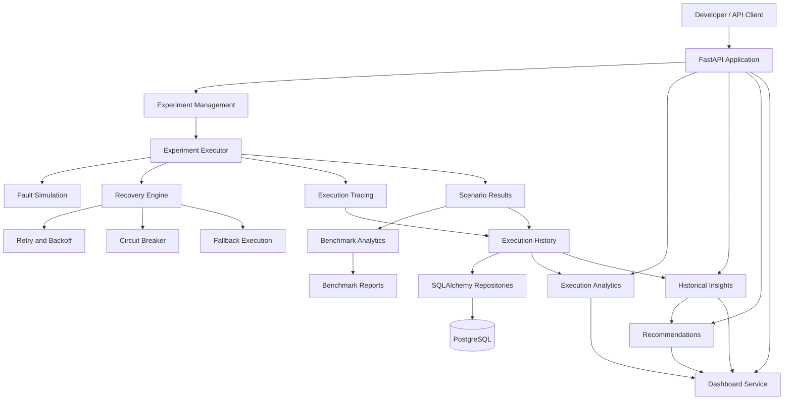

# AgentFault Lab

### AI Agent Reliability Testing, Chaos Engineering & Evaluation Platform

AgentFault Lab is a Python-based platform for testing, benchmarking, and analyzing the reliability of AI agent executions under simulated failure conditions.

It provides a structured environment to evaluate how recovery mechanisms such as retries, exponential backoff, fallback strategies, and circuit breakers influence execution success, latency, and reliability.

The platform combines configurable failure scenarios, experiment execution, execution tracing, benchmark analytics, historical insights, and reliability recommendations through a FastAPI interface.

---

## Table of Contents

- [Overview](#overview)
- [Why AgentFault Lab?](#why-agentfault-lab)
- [Core Features](#core-features)
- [Architecture](#architecture)
- [Technology Stack](#technology-stack)
- [Project Structure](#project-structure)
- [Getting Started](#getting-started)
- [Running the API](#running-the-api)
- [API Reference](#api-reference)
- [Benchmark Example](#benchmark-example)
- [Database Architecture](#database-architecture)
- [Testing and Code Coverage](#testing-and-code-coverage)
- [Research Focus](#research-focus)
- [Current Limitations](#current-limitations)
- [Roadmap](#roadmap)

---

## Overview

AI agents increasingly depend on external tools, APIs, databases, and services to complete tasks. These dependencies can fail because of network interruptions, timeouts, rate limits, invalid responses, or temporary service outages.

An agent that works under ideal conditions may behave unpredictably when these failures occur.

AgentFault Lab addresses this problem by providing a controlled environment in which reliability strategies can be evaluated under repeatable failure conditions.

The platform enables developers to:

- Configure reliability experiments.
- Simulate different failure conditions.
- Execute scenarios using configurable recovery strategies.
- Track execution attempts and recovery behavior.
- Compare different reliability configurations.
- Measure execution success rates and latency.
- Generate benchmark reports.
- Analyze historical execution performance.
- Generate reliability improvement recommendations.

## Why AgentFault Lab?

Traditional testing often focuses on whether an application works under normal conditions. However, AI agent systems also need to be evaluated on how they behave when their tools and dependencies fail.

AgentFault Lab focuses on questions such as:

- Does retry logic improve task completion?
- When does exponential backoff provide better results?
- How do circuit breakers affect repeated failures?
- Does fallback execution improve reliability?
- What is the latency overhead of recovery strategies?
- Which reliability configuration performs best across different failure scenarios?

The goal is to make AI agent reliability measurable, repeatable, and easier to improve.

---

## Core Features

### 1. Fault Simulation

Simulate failures that can occur during tool execution.

Supported fault and scenario handling includes:

- Timeout failures.
- Rate-limit failures.
- Malformed responses.
- Unknown or unexpected failures.
- Stochastic failure scenarios.

### 2. Reliability and Recovery Strategies

Evaluate different execution recovery mechanisms.

- Configurable retry behavior.
- Exponential backoff.
- Circuit breaker.
- Fallback execution.
- Bounded execution and recovery handling.

### 3. Experiment Management

Create and manage reliability experiments containing multiple failure scenarios.

- Create experiments.
- Retrieve and list experiments.
- Execute configured experiments.
- Retrieve execution results.
- Maintain execution history.
- Delete eligible experiments.

### 4. Execution Tracing

Capture execution information to understand how an agent behaves during a scenario.

Track information such as:

- Execution identifiers.
- Execution events.
- Attempt numbers.
- Execution status.
- Error information.
- Execution duration.
- Retry and fallback behavior.

### 5. Benchmarking and Evaluation

Evaluate execution behavior using measurable metrics.

- Execution success rate.
- Failed and passed scenarios.
- Retry counts.
- Fallback usage.
- Execution latency.
- Evaluation scores.
- Benchmark analytics.
- Strategy comparisons.

### 6. Historical Analytics

Analyze experiment performance over time.

- Historical success-rate trends.
- Latency trends.
- Retry trends.
- Fallback trends.
- Best and worst experiment analysis.
- Historical experiment comparisons.
- Reliability summaries.

### 7. Reliability Recommendations

Generate and manage recommendations based on experiment reliability analysis.

- Generate recommendations.
- Retrieve recommendations.
- Filter by priority, category, and status.
- View recommendation summaries.

### 8. Persistent Execution History

The database-backed execution service supports persistent experiment execution records, scenario results, and trace events.

The API exposes endpoints to retrieve stored execution runs and their associated scenario traces.

### 9. REST API

FastAPI provides access to experiment management, execution, benchmarking, analytics, historical insights, and recommendation workflows.

Interactive API documentation is available through Swagger UI.

---

## Architecture

The following diagram represents the major logical components of AgentFault Lab.



### High-Level Execution Flow

1. A developer creates a reliability experiment.
2. The experiment contains one or more failure scenarios.
3. The experiment executor runs the scenarios.
4. Fault simulation introduces the configured failure conditions.
5. Recovery mechanisms handle failures according to the reliability configuration.
6. Execution traces and scenario results are collected.
7. Benchmark analytics calculate execution performance.
8. Historical analytics and recommendations help evaluate reliability.

---

## Technology Stack

| Category | Technologies |
|---|---|
| Programming language | Python 3.13+ |
| API framework | FastAPI |
| ASGI server | Uvicorn |
| Data validation | Pydantic |
| Database | PostgreSQL 17 |
| ORM | SQLAlchemy |
| Database migrations | Alembic |
| PostgreSQL driver | Psycopg 3 |
| Testing | Pytest |
| API testing | HTTPX |
| Coverage | pytest-cov |
| Containerization | Docker Compose |
| API documentation | OpenAPI / Swagger UI |
| Version control | Git and GitHub |

---

## Project Structure

```text
AgentFault-Lab/
│
├── api/
│   ├── main.py
│   ├── dependencies.py
│   ├── routes/
│   │   ├── experiments.py
│   │   ├── execution_analytics.py
│   │   ├── insights.py
│   │   └── recommendations.py
│   └── schemas/
│
├── docs/
│   └── progress.md
│
├── examples/
│   ├── run_benchmark.py
│   ├── run_automated_benchmark.py
│   ├── day21_report_demo.py
│   ├── day22_storage_demo.py
│   ├── day23_report_manager_demo.py
│   ├── day24_historical_analytics_demo.py
│   ├── day25_historical_insights_demo.py
│   ├── day26_recommendation_engine_demo.py
│   ├── day27_recommendation_manager_demo.py
│   └── day28_dashboard_demo.py
│
├── src/
│   └── agentfault/
│       ├── agent_config.py
│       ├── agent_executor.py
│       ├── backoff.py
│       ├── benchmark.py
│       ├── benchmark_analytics.py
│       ├── benchmark_report.py
│       ├── benchmark_runner.py
│       ├── circuit_breaker.py
│       ├── dashboard_service.py
│       ├── evaluation.py
│       ├── experiment.py
│       ├── experiment_comparator.py
│       ├── experiment_executor.py
│       ├── experiment_manager.py
│       ├── fallback.py
│       ├── faults.py
│       ├── historical_analytics.py
│       ├── historical_insights.py
│       ├── metrics.py
│       ├── models.py
│       ├── recommendation_engine.py
│       ├── recommendation_manager.py
│       ├── reliability_config.py
│       ├── reliability_engine.py
│       ├── report_manager.py
│       ├── report_storage.py
│       ├── retry.py
│       ├── safe_execution.py
│       ├── scenarios.py
│       ├── scenario_runner.py
│       ├── stochastic_benchmark_runner.py
│       ├── stochastic_faults.py
│       ├── stochastic_runner.py
│       ├── stochastic_scenarios.py
│       ├── stochastic_scenario_runner.py
│       ├── tracing.py
│       │
│       ├── database/
│       │   ├── base.py
│       │   ├── session.py
│       │   ├── migrations/
│       │   ├── models/
│       │   └── repositories/
│       │
│       └── services/
│           ├── execution_analytics_service.py
│           ├── execution_reliability_service.py
│           └── experiment_service.py
│
├── tests/
├── reports/
├── htmlcov/
├── docker-compose.yml
├── alembic.ini
├── pyproject.toml
└── README.md
```

---

## Getting Started

### Prerequisites

- Python 3.13 or later.
- Git.
- Docker Desktop (for PostgreSQL).
- PostgreSQL 17 (if running the database without Docker).

### 1. Clone the Repository

```powershell
git clone https://github.com/shambavi-10/AgentFault-Lab.git

cd AgentFault-Lab
```

### 2. Create a Virtual Environment

```powershell
py -3.13 -m venv .venv

.\.venv\Scripts\Activate.ps1
```

### 3. Install Dependencies

The current `pyproject.toml` defines the package metadata and build configuration, but does not yet declare the complete runtime and development dependency list.

The following installs the core packages verified in the development environment:

```powershell
python -m pip install fastapi uvicorn sqlalchemy alembic psycopg httpx pytest pytest-cov
```

Additional dependencies required by individual modules may need to be installed separately until the dependency manifest is completed.

### 4. Configure Python Module Paths

From the project root, set the source and project directories on the Python module path:

```powershell
$env:PYTHONPATH = "src;."
```

### 5. Run the Test Suite

```powershell
python -m pytest -q
```

For coverage:

```powershell
python -m pytest --cov=src --cov-report=term-missing
```

---

## Running the API

Start the FastAPI application from the project root:

```powershell
$env:PYTHONPATH = "src;."

python -m uvicorn api.main:app --reload
```

The default local server address is:

```text
http://127.0.0.1:8000
```

### API Documentation

| Resource | URL |
|---|---|
| Swagger UI | http://127.0.0.1:8000/docs |
| ReDoc | http://127.0.0.1:8000/redoc |
| OpenAPI schema | http://127.0.0.1:8000/openapi.json |
| Health check | http://127.0.0.1:8000/health |

The API also provides a root endpoint:

```text
GET /
```

---

## API Reference

All application API routes use the `/api/v1` prefix, except the root and health endpoints.

### System

| Method | Endpoint | Description |
|---|---|---|
| GET | `/` | API information |
| GET | `/health` | Health check |
| GET | `/api/v1/dashboard` | Aggregated dashboard data |

### Experiment Management

Base path: `/api/v1/experiments`

| Method | Endpoint | Description |
|---|---|---|
| POST | `/api/v1/experiments` | Create an experiment |
| GET | `/api/v1/experiments` | List experiments |
| GET | `/api/v1/experiments/{experiment_id}` | Retrieve an experiment |
| DELETE | `/api/v1/experiments/{experiment_id}` | Delete an eligible experiment |
| POST | `/api/v1/experiments/{experiment_id}/run` | Execute an experiment |
| GET | `/api/v1/experiments/{experiment_id}/results` | Retrieve the latest results |
| GET | `/api/v1/experiments/{experiment_id}/history` | Retrieve execution history |
| POST | `/api/v1/experiments/compare` | Compare reliability strategies |
| GET | `/api/v1/experiments/{experiment_id}/analytics` | Retrieve benchmark analytics |
| POST | `/api/v1/experiments/{experiment_id}/report` | Generate a benchmark report |
| GET | `/api/v1/experiments/{experiment_id}/report` | Retrieve a saved report |
| GET | `/api/v1/experiments/{experiment_id}/report/json` | Export a report as JSON |
| GET | `/api/v1/experiments/{experiment_id}/runs` | List persistent execution runs |
| GET | `/api/v1/experiments/{experiment_id}/runs/{run_id}` | Retrieve a persistent execution run |
| GET | `/api/v1/experiments/{experiment_id}/runs/{run_id}/traces` | Retrieve scenario traces |

Persistent execution-run endpoints require database-backed execution storage.

### Execution Analytics

Base path: `/api/v1/execution-analytics`

| Method | Endpoint | Description |
|---|---|---|
| GET | `/overview` | Aggregate execution metrics |
| GET | `/trends/success` | Success-rate trends |
| GET | `/trends/latency` | Latency trends |
| GET | `/trends/retries` | Retry trends |
| GET | `/trends/fallbacks` | Fallback trends |
| GET | `/trends/circuit-breaker` | Circuit-breaker trends |
| GET | `/reliability` | Execution reliability summary |

### Historical Insights

Base path: `/api/v1/insights`

| Method | Endpoint | Description |
|---|---|---|
| GET | `/` | Insights for all experiments |
| GET | `/trends/success` | Historical success-rate trends |
| GET | `/trends/latency` | Historical latency trends |
| GET | `/trends/retries` | Historical retry trends |
| GET | `/trends/fallbacks` | Historical fallback trends |
| GET | `/best` | Best-performing experiment |
| GET | `/worst` | Worst-performing experiment |
| GET | `/summary` | Historical reliability summary |
| GET | `/compare` | Compare two experiments |
| GET | `/{experiment_id}` | Insights for one experiment |

The comparison endpoint accepts the query parameters `first_experiment_id` and `second_experiment_id`.

Example:

```text
GET /api/v1/insights/compare?first_experiment_id=experiment-1&second_experiment_id=experiment-2
```

### Recommendations

Base path: `/api/v1/recommendations`

| Method | Endpoint | Description |
|---|---|---|
| POST | `/generate/{experiment_id}` | Generate recommendations |
| GET | `/` | List recommendations |
| GET | `/summary` | Recommendation summary |
| GET | `/{recommendation_id}` | Retrieve a recommendation |

The listing endpoint supports optional `priority`, `category`, and `status` query parameters.

---

## Benchmark Example

AgentFault Lab includes a benchmark example that evaluates three execution configurations:

1. No retries.
2. Basic retries.
3. Retries with exponential backoff.

Each configuration is evaluated using execution count, successful executions, retry count, latency, and evaluation scores.

Run the example from the project root:

```powershell
$env:PYTHONPATH = "src;."

python examples/run_benchmark.py
```

### Example Benchmark Configuration

```python
from agentfault.benchmark import (
    calculate_benchmark,
    generate_benchmark_report
)


# Agent A: No retries
agent_a = calculate_benchmark(
    agent_name="Agent A - No Retry",
    total_executions=10,
    successful_executions=6,
    total_retries=0,
    total_latency=8.0,
    evaluation_scores=[0.9, 0.8, 0.7, 0.9, 0.8]
)

# Agent B: Basic retries
agent_b = calculate_benchmark(
    agent_name="Agent B - Basic Retry",
    total_executions=10,
    successful_executions=8,
    total_retries=5,
    total_latency=15.0,
    evaluation_scores=[0.9, 0.9, 0.8, 0.9, 0.9]
)

# Agent C: Exponential backoff
agent_c = calculate_benchmark(
    agent_name="Agent C - Exponential Backoff",
    total_executions=10,
    successful_executions=9,
    total_retries=7,
    total_latency=18.0,
    evaluation_scores=[1.0, 0.9, 0.9, 1.0, 0.9]
)

results = [agent_a, agent_b, agent_c]

report = generate_benchmark_report(results)

print(report)
```

This example illustrates how different retry configurations can be compared using a consistent benchmark input.

---

## Database Architecture

AgentFault Lab uses SQLAlchemy for database access, Alembic for schema migrations, and PostgreSQL for relational persistence.

The database layer includes models and repositories for:

- Tenants.
- Experiments.
- Experiment execution runs.
- Scenario execution results.
- Execution trace events.

### PostgreSQL with Docker Compose

The repository includes a PostgreSQL 17 service.

The Compose configuration uses:

| Setting | Value |
|---|---|
| Image | `postgres:17` |
| Container name | `agentfault-postgres` |
| Database | `agentfault` |
| Username | `postgres` |
| Port | `5432` |
| Persistent volume | `agentfault_postgres_data` |

The database password is supplied through the `POSTGRES_PASSWORD` environment variable.

Start PostgreSQL:

```powershell
docker compose up -d postgres
```

Check the container:

```powershell
docker compose ps
```

Stop the service:

```powershell
docker compose down
```

The named volume preserves database data when the container is stopped or removed. Removing the volume is a separate operation and can permanently delete stored data.

Database-backed application execution also requires configuring the application's database connection settings and applying the appropriate migrations.

---

## Testing and Code Coverage

Automated tests are implemented using Pytest.

The test suite covers areas including:

- Fault simulation.
- Agent execution.
- Retry and backoff behavior.
- Circuit-breaker behavior.
- Fallback execution.
- Scenario execution.
- Stochastic scenarios.
- Benchmark calculations.
- Experiment management.
- Historical analytics.
- Recommendation generation.
- Database repositories.
- API behavior.
- Execution reliability services.

### Latest Verification Results

**Latest recorded local test run — November 11, 2026**

| Metric | Result |
|---|---:|
| Tests passed | 644 |
| Tests failed | 0 |
| Overall statement coverage | 99% |
| Uncovered statements | 1 |
| Test warning | 1 |

The remaining uncovered statement is a defensive unexpected-state exception in the retry implementation. It is retained rather than forcing an artificial execution path solely to increase the coverage percentage.

Run the tests:

```powershell
python -m pytest -q
```

Generate a coverage report:

```powershell
python -m pytest --cov=src --cov-report=term-missing
```

Generate an HTML coverage report:

```powershell
python -m pytest --cov=src --cov-report=html
```

Open the generated report:

```powershell
Start-Process htmlcov/index.html
```

---

## Research Focus

The central research question behind AgentFault Lab is:

**How do different recovery strategies affect task success, safety, latency, and cost under tool failures?**

The platform provides a foundation for investigating reliability behavior through repeatable experiments and measurable execution outcomes.

Potential evaluation dimensions include:

- Task completion rate.
- Recovery success rate.
- Retry overhead.
- Execution latency.
- Fallback effectiveness.
- Circuit-breaker behavior.
- Evaluation quality.

---

## Current Limitations

AgentFault Lab is an actively developed engineering project. The following distinctions are important:

- The project provides a FastAPI application, but a complete production deployment has not been established by the current project evidence.
- Persistent execution history requires the database-backed execution service; not all API execution results use persistent storage.
- The current package metadata does not yet declare the complete runtime and development dependencies.
- Authentication and authorization should be implemented and security-reviewed before exposing the API to untrusted users.
- Tenant isolation and database access controls require further security validation before making production multi-tenant guarantees.
- The current README documents implemented API routes; it does not imply that a separate production web dashboard has been deployed.

---

## Roadmap

Potential next development priorities:

- [ ] Complete dependency management in `pyproject.toml`.
- [ ] Add reproducible environment setup and configuration documentation.
- [ ] Strengthen API authentication and authorization.
- [ ] Complete tenant-isolation and access-control validation.
- [ ] Expand API integration and database integration testing.
- [ ] Improve benchmark reproducibility and performance evaluation.
- [ ] Add deployment configuration and CI/CD automation.
- [ ] Publish a demonstration environment and project walkthrough.
- [ ] Add architecture diagrams and benchmark visualizations.

---

## Contributing

Contributions, bug reports, and suggestions are welcome.

A useful contribution workflow:

1. Fork the repository.
2. Create a feature branch.
3. Implement the change.
4. Add or update automated tests.
5. Run the test suite.
6. Submit a pull request with a clear description.

---

## License

A license has not yet been specified in the current repository metadata. Add a `LICENSE` file before presenting the project as open source under a particular license.

---

**AgentFault Lab — Making AI Agent Reliability Measurable.**